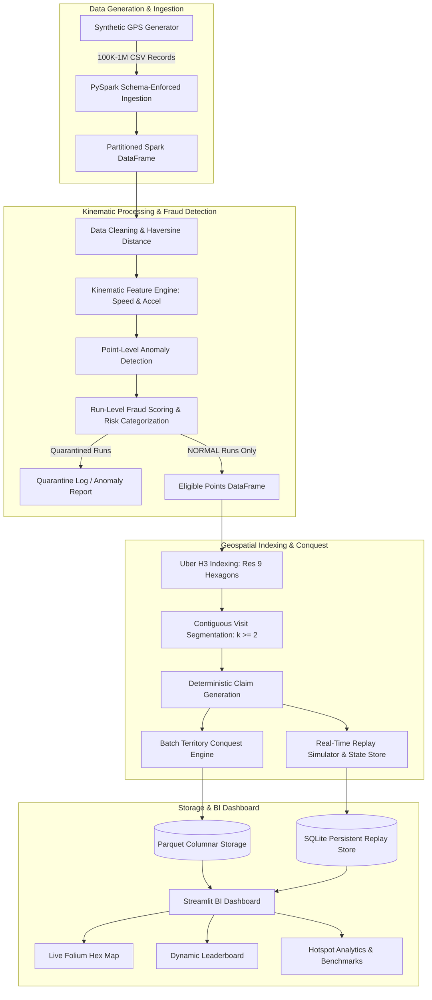

# Real-Time Territory Control and Hotspot Analysis Using Geospatial Big Data

[](https://www.python.org/)
[](https://spark.apache.org/)
[](https://h3geo.org/)
[](https://streamlit.io/)
[](https://microsoft.com)
[](#)

---

## 1. Project Overview & Architecture

An end-to-end Big Data Analytics and interactive Business Intelligence platform for **geospatial territory conquest, fraud detection, and hotspot analysis** in outdoor athletic competitions.

The platform ingests high-frequency GPS telemetry, enforces kinematic movement constraints, quarantines fraudulent activities (teleportation, motor vehicles, GPS multipath spikes), discretizes continuous spherical space into **Uber H3 Resolution 9 hexagonal cells** (~0.1 km²), evaluates contiguous zone visits with re-entry support, awards territory ownership deterministically, calculates composite hotspot metrics, and provides **simulated real-time micro-batch replay with 100% mathematical equivalence to distributed batch execution**.



---

## 2. Technology Stack & Environment

- **Operating System:** Windows 11 (64-bit)
- **Language Runtime:** Python 3.11.5 (64-bit isolated virtual environment `.venv`)
- **Java Platform:** Java JDK 17 / 23 (64-bit), `JAVA_HOME` configured
- **Distributed Computing:** Apache PySpark 4.2.0 (`master=local[2]`, `driver-memory=2g`, `shuffle-partitions=4`)
- **Geospatial Indexing:** Uber H3 v4.5.0 (`h3.latlng_to_cell`, Resolution 9 $\sim 0.1\text{ km}^2$, 174m edge length)
- **Columnar Storage:** Apache Parquet, PyArrow 26.0, Pandas 3.1
- **Persistence Store:** SQLite 3 (WAL journal mode, ACID transactions)
- **Production Dashboard:** Streamlit 1.66.1 with `@st.fragment` sub-second updates
- **Cartography:** Folium 0.20.0 / Leaflet with dynamic hexagonal boundaries and deterministic runner styling
- **Charting & Plots:** Plotly Express & Plotly Graph Objects 7.1.0
- **Testing & QA:** Pytest 9.1.1 (89 automated unit, integration, consistency, and equivalence tests)

---

## 3. Quick Start & One-Click Launch (Windows PowerShell)

### One-Click Launch
To start the application with automated pre-flight checks (virtualenv validation, dependency verification, Parquet data check, and Streamlit startup):
```powershell
powershell -ExecutionPolicy Bypass -File scripts\start_project.ps1
```

### One-Click Demo Preparation
To reset state, verify Parquet datasets, run consistency tests, generate fresh demo telemetry, and prepare for presentation:
```powershell
powershell -ExecutionPolicy Bypass -File scripts\prepare_demo.ps1
```

### Manual Quick Start Guide

#### Step 1: Environment Activation
```powershell
cd D:\BDA
.\.venv\Scripts\Activate.ps1
```

#### Step 2: System Health Audit
```powershell
powershell -ExecutionPolicy Bypass -File scripts\check_project.ps1
```

#### Step 3: Run Distributed Big Data Batch Pipeline (Optional)
```powershell
python -m src.pipeline --input data/raw/gps_100k.csv --output data/parquet --h3-resolution 9 --min-consecutive 2
```

#### Step 4: Launch BI Production Dashboard
```powershell
powershell -ExecutionPolicy Bypass -File scripts\start_project.ps1
```
Open your browser to `http://localhost:8501`.

---

## 4. Real-Time GPS Replay Simulation (Day 4 Feature)

The **⚡ Live Simulation** page provides interactive, simulated real-time micro-batch streaming:
- **Bi-Temporal Decoupling:** Event timestamps dictate chronological ordering. Playback speed only controls wall-clock advancement rate.
- **Micro-Batch Slicing:** Events are grouped into configurable intervals (default 5.0 seconds).
- **Controls:** Fully operational `START`, `PAUSE`, `RESUME`, `STOP`, and `RESTART`.
- **Playback Speeds:** 1x, 2x, 5x, and 10x speed multipliers.
- **Transactional State Persistence:** SQLite stores committed batches, current ownership, and checkpoints with ACID guarantees.
- **Cross-Batch Continuity:** Runner dwell counts persist across micro-batch boundaries, ensuring multi-batch zone visits confirm claims accurately.
- **Live Cartography:** Real-time Folium map highlighting newly captured zones (emerald ring) and takeovers (fiery red ring) with deterministic runner colors.
- **Live Leaderboard:** Enforces the **Conservation of Territory Law** ($\sum \text{Zones Owned} \equiv N_{\text{owned hexagons}}$).

---

## 5. Performance Benchmarking & Scaling

Run the automated big data benchmarking suite:
```powershell
.\scripts\run_benchmarks.ps1 -Scales "100k"
```

### Empirical Results (Intel Core / Local[2] / Windows 11)
| Scale | Records | File Size | Ingestion | Cleaning | Fraud | H3 Index | Conquest | Parquet | Total Time | Throughput |
| :---: | :---: | :---: | :---: | :---: | :---: | :---: | :---: | :---: | :---: | :---: |
| **100K** | 100,000 | 11.22 MB | 10.70 s | 20.00 s | 6.76 s | 0.19 s | 18.88 s | 26.98 s | **101.16 s** | **988.5 rec/s** |

Results are exported to:
- `data/reports/benchmark_results.csv`
- `data/reports/benchmark_results.json`

---

## 6. Batch vs. Replay Academic Equivalence Validation

A critical academic milestone of Day 4 is verifying that replaying prevalidated GPS telemetry chronologically produces the **exact same territory ownership** as Day 2 batch execution:

```powershell
python -m pytest tests/test_replay_integration.py -k test_batch_vs_replay_full_equivalence
```

### Verified Parity Metrics across 75,425 Eligible GPS Points:
- **Total Valid Claims:** 5,075 (Batch) vs. 5,075 (Replay) — **100% Match**
- **Unique Owned Hexagons:** 308 (Batch) vs. 308 (Replay) — **100% Match**
- **Initial Captures:** 308 (Batch) vs. 308 (Replay) — **100% Match**
- **Takeovers:** 4,729 (Batch) vs. 4,729 (Replay) — **100% Match**
- **Same-Owner Revisits:** 38 (Batch) vs. 38 (Replay) — **100% Match**
- **Final Zone Owners:** **0 mismatches** across all 308 zones.

---

## 7. Automated Test Suite

Execute the full suite of automated tests:
```powershell
# Run all automated tests (89 tests)
python -m pytest

# Run Day 4 real-time simulation and integration tests
python -m pytest tests/test_batch_processor.py tests/test_incremental_ownership.py tests/test_realtime_analytics.py tests/test_replay_state.py tests/test_replay_engine.py tests/test_replay_integration.py
```

---

## 8. Final System Validation Script

Execute the complete end-to-end health audit script:
```powershell
powershell -ExecutionPolicy Bypass -File scripts/final_validation.ps1
```
Generates `docs/final_validation_report.md` confirming all 42 validation checks passed.

---

## 9. Project Directory Structure

```
D:\territory-analytics/
├── config/
│   └── settings.yaml                  # Global configuration (geospatial, spark, fraud heuristics)
├── dashboard/
│   ├── app.py                         # Streamlit BI app entrypoint
│   ├── assets/
│   │   └── custom.css                 # Dark theme custom stylesheet
│   ├── components/
│   │   ├── charts.py                  # Plotly time-series, donut, and bar charts
│   │   ├── live_event_feed.py         # Real-time conquest activity notifications feed
│   │   ├── live_metrics.py            # Live KPI metric cards for simulation
│   │   ├── maps.py                    # Folium interactive H3 hexagonal cartography
│   │   ├── metric_cards.py            # Styled KPI metric cards
│   │   ├── replay_controls.py         # START/PAUSE/RESUME/STOP/RESTART controls
│   │   ├── sidebar.py                 # Sidebar navigation and provenance metadata
│   │   └── tables.py                  # Formatted data tables
│   ├── pages/
│   │   ├── activity_analytics.py      # Diurnal temporal and distance analytics
│   │   ├── cheat_detection.py         # Anomaly evaluation and confusion matrices
│   │   ├── hotspot_analysis.py        # Composite hotspot rankings and heatmaps
│   │   ├── leaderboard.py             # Multi-metric participant rankings
│   │   ├── live_simulation.py         # Real-time GPS stream replay page
│   │   ├── overview.py                # Executive summary and platform KPIs
│   │   ├── runner_explorer.py         # Athlete dossiers and personal routes
│   │   └── territory_map.py           # Historical territory conquest map
│   └── services/
│       ├── data_loader.py             # Columnar Parquet loader using PyArrow
│       ├── exports.py                 # CSV serialization service
│       ├── filters.py                 # Multi-dimensional filtering logic
│       └── metrics.py                 # KPI and hotspot score calculations
├── data/
│   ├── benchmarks/                    # Benchmark run Parquet outputs
│   ├── parquet/                       # Snappy-compressed columnar datasets
│   ├── raw/                           # Raw synthetic GPS CSV datasets
│   ├── reports/                       # Validation and benchmark JSON/CSV reports
│   └── replay_state.db                # SQLite ACID persistent replay state store
├── docs/
│   ├── demo_script.md                 # 5-7 minute live defense demonstration script
│   ├── final_project_report.md        # Comprehensive 24-section academic report
│   ├── final_validation_report.md     # 42-check system health audit report
│   ├── presentation_content.md        # 12-slide academic defense presentation
│   └── viva_questions.md              # 20 viva voce questions with technical answers
├── scripts/
│   ├── final_validation.ps1           # Automated system verification script
│   ├── run_benchmarks.ps1             # Big data performance benchmarking script
│   └── setup.ps1                      # Windows environment setup script
├── src/
│   ├── analytics.py                   # Distributed analytics and leaderboard generation
│   ├── benchmark.py                   # Performance profiling and benchmarking engine
│   ├── cheat_detection.py             # Kinematic rule-based anomaly detection
│   ├── data_cleaning.py               # Distributed Haversine and kinematic calculations
│   ├── data_generator.py              # Synthetic GPS trajectory generator
│   ├── data_ingestion.py              # Explicit StructType PySpark ingestion
│   ├── geo_utils.py                   # Great-circle distance and spherical trigonometry
│   ├── h3_indexing.py                 # Uber H3 v4 spatial projection
│   ├── pipeline.py                    # End-to-end distributed orchestration
│   ├── realtime/
│   │   ├── batch_processor.py         # Chronological micro-batch partitioner
│   │   ├── incremental_ownership.py   # Stateful incremental conquest engine
│   │   ├── realtime_analytics.py      # Live hotspot and leaderboard updates
│   │   ├── replay_engine.py           # Thread-safe simulation controller
│   │   ├── replay_state.py            # Strongly-typed data models and state enums
│   │   └── state_store.py             # SQLite transactional persistence store
│   ├── spark_session.py               # Windows-friendly local SparkSession factory
│   ├── storage.py                     # Parquet export and reader routines
│   └── utils.py                       # Project paths and YAML configuration loader
├── tests/                             # Comprehensive automated test suite (89 tests)
├── .gitignore                         # Clean git repository exclusions
├── pytest.ini                         # Pytest configuration
├── README.md                          # Master documentation
└── requirements.txt                   # Pinned dependency requirements
```

---

## 10. Troubleshooting & Common Issues

1. **PySpark JVM / Python Mismatch on Windows:**
   - Ensure both Python (64-bit) and Java JDK (64-bit) match architecture.
   - `src/spark_session.py` auto-configures `PYSPARK_PYTHON` and `PYSPARK_DRIVER_PYTHON` to `sys.executable`.
2. **Spark Temporary Directory Locks on Windows:**
   - `spark.local.dir` and `SPARK_LOCAL_DIRS` are explicitly routed to `data/spark-temp` to prevent Windows `%TEMP%` collision and random deletion.
3. **Streamlit Port Conflicts:**
   - Launch on a custom port: `streamlit run dashboard/app.py --server.port 8502`.
4. **Replay Engine Reset:**
   - If the replay simulation is interrupted, click **🔄 RESTART** in the Live Simulation page or run `SQLiteStateStore().reset_session("academic_demo_replay")`.

---

## 11. Academic Defense Readiness

- [x] Complete 4-day development trajectory fully implemented.
- [x] All 89 automated tests pass without regression.
- [x] 100% equivalence between batch conquest and real-time replay mathematically verified.
- [x] Comprehensive 24-section Academic Final Report generated (`docs/final_project_report.md`).
- [x] 12-slide Presentation Content prepared (`docs/presentation_content.md`).
- [x] 20 Viva Voce Questions with accurate answers prepared (`docs/viva_questions.md`).
- [x] Step-by-step 5-7 minute Demonstration Script prepared (`docs/demo_script.md`).
- [x] Automated System Health Audit verified (`docs/final_validation_report.md`).
- [x] Clean Git repository configuration.
