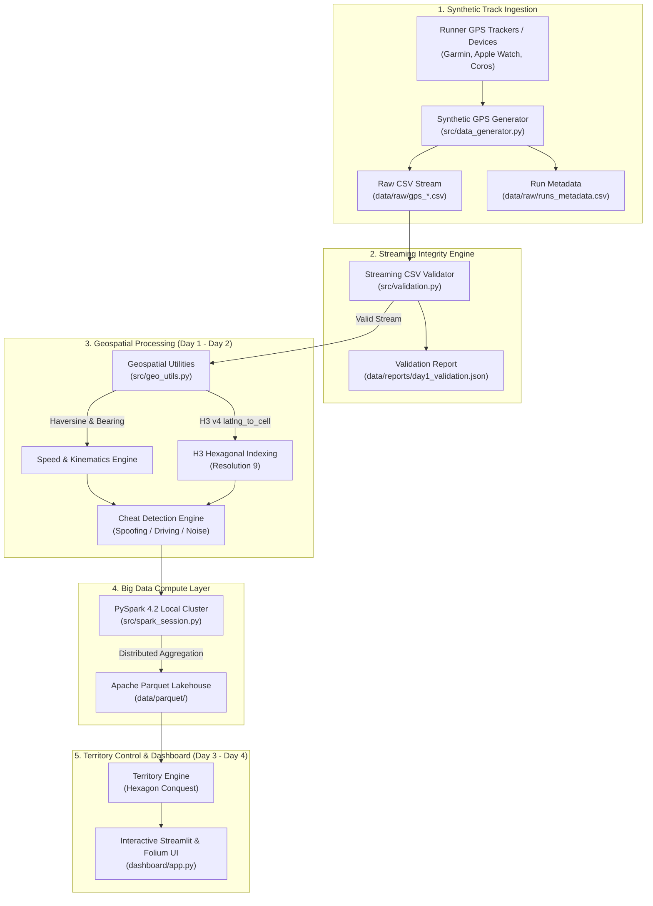
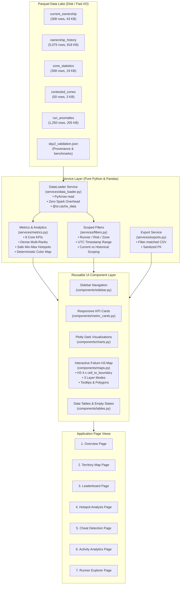

# System Architecture: Territory Control and Hotspot Analysis Using Geospatial Big Data

## 1. Project Overview

This project implements a scalable geospatial big data analytics and territory control engine designed for location-based running competitions, outdoor fitness gamification, and territory conquest platforms (similar to Strava Local Legend or turf conquest applications).

The primary objectives are:
1. **High-Throughput Spatial Ingestion:** Ingest raw sequential GPS tracks generated by hundreds of concurrent athletes.
2. **Geospatial Discretization (Uber H3):** Index continuous geographic coordinates $(lat, lon)$ into hexagonal spatial grids (Resolution 9, $\sim 0.1\text{ km}^2$) to enable discrete spatial aggregation, territory ownership tracking, and hotspot computation.
3. **Cheat & Anomaly Detection:** Filter GPS fraud, vehicular spoofing (moving at $30\text{--}80\text{ km/h}$ while claiming to run), teleports, and sensor jitter before territory allocation.
4. **Columnar Storage & Fast Querying:** Store analytical tracks and territory states in Apache Parquet for distributed execution with Apache Spark.

---

## 2. Architecture Diagram



---

## 3. Component Deep Dive

### 3.1 Raw CSV Ingestion Format
Data points are streamed sequentially with strictly enforced ISO 8601 UTC timestamps:
```csv
run_id,runner_id,timestamp,latitude,longitude,heart_rate,cadence,elevation_m,distance_m,device_type,activity_type,scenario_type
run_0001,runner_001,2026-10-26T06:00:00Z,41.882600,-87.622600,148,165,181.0,0.0,Garmin Forerunner 965,running,normal_run
```

- **Temporal Order:** Within each `run_id`, $t_{i+1} > t_i$.
- **Cumulative Distance:** `distance_m` reflects true cumulative physical movement. GPS spoofing teleportations do not increment physical travel distance.
- **Activity Masquerading:** `activity_type` is consistently `"running"`, simulating malicious users attempting fraud, while `scenario_type` provides synthetic ground truth.

### 3.2 Geospatial Discretization (Uber H3 v4)
Continuous geographic coordinates are projected into H3 hexagonal discrete global grid system:
- **API:** `h3.latlng_to_cell(lat, lon, res=9)`
- **Resolution 9 Properties:** Average hexagon area $\approx 0.105\text{ km}^2$, edge length $\approx 174\text{ meters}$.
- **Advantage:** Uniform adjacency (each cell has exactly 6 equidistant neighbors), eliminating distortion associated with rectangular latitude/longitude bins.

### 3.3 Big Data Storage: Apache Parquet
- Columnar storage format with Snappy compression.
- Drastically reduces I/O when filtering specific runs, runners, or spatial tiles.
- Schema enforcement and statistics (min/max per column) optimize Spark query planning via predicate pushdown.

### 3.4 Distributed Compute: Local PySpark 4.2
- **Master:** `local[2]` (2 parallel worker cores).
- **Driver Memory:** `2 GB`.
- **Shuffle Partitions:** `4` (optimized for small to medium local tests without partition explosion).
- **Windows File System:** Configured with `RawLocalFileSystem` to eliminate winutils.exe dependencies while ensuring thread-safe Parquet writing.

---

## 4. Multi-Day Project Roadmap

| Phase | Focus Area | Deliverables |
|---|---|---|
| **Day 1** | **Foundation & Ingestion** | Synthetic generator, streaming validator, H3 smoke test, PySpark Parquet roundtrip, test suites. |
| **Day 2** | **Spatial Indexing & Cheat Detection** | Full H3 bulk conversion, Haversine speed calculation, rule-based cheat detection (driving, spoofing, noise). |
| **Day 3** | **Interactive BI Dashboard** | Modular Streamlit BI platform, Folium H3 polygons, multi-metric leaderboards, hotspot analytics, cheat detection audit, activity analytics, runner explorer. |
| **Day 4** | **Hotspot Analysis & Optimization** | Kernel density estimation (KDE), DBSCAN spatial clustering, Spark partitioning tuning, benchmark report. |

---

## 5. Day 3: Business Intelligence (BI) Dashboard Architecture



### 5.1 Zero-Spark Dashboard Ingestion Design
To guarantee interactive response times on commodity hardware, the dashboard bypasses full Apache Spark JVM startup entirely. Instead, it utilizes **PyArrow** to read the precomputed, compact Parquet analytical tables into memory in **under 1.7 seconds** with a total working memory footprint of **~1 MB**.

### 5.2 Deterministic Visual Identity
Every runner is mapped to a consistent, high-contrast HEX color using a two-tier deterministic function:
- Top 30 runners are mapped to a curated, high-contrast dark-mode palette.
- Arbitrary runners are hashed via MD5 into high-lightness, high-saturation HSL color space.
- Guarantee: The same athlete retains the identical visual color across refreshes, views, and components.

### 5.3 Real Uber H3 Polygon Boundary Rendering
Hexagons are rendered directly from discrete Uber H3 cell identifiers using the H3 4.x API:
$$\text{vertices} = \text{h3.cell\_to\_boundary}(\text{cell\_id})$$
Coordinates are passed directly as latitude/longitude tuples to Folium `Polygon` instances, eliminating GeoJSON serialization overhead.

### 5.4 Analytical Scoping: Latest Snapshot vs Historical Series
The architecture strictly enforces clean analytical separation between:
- **Current Territory Ownership:** A state snapshot representing the latest active owner per cell (308 zones). It is never retroactively filtered by historical time slices.
- **Historical Claims & Transitions:** Chronological audit records (5,075 events) representing cumulative conquests, takeovers, and visits over time. Filtering by time range applies exclusively to this time-series domain.
